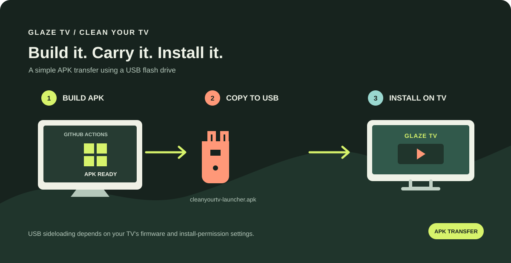

# CleanYourTV for GLAZE TV

Build the CleanYourTV launcher APK with GitHub Actions, copy it to a USB flash drive, and install it on a compatible GLAZE TV.

## Build the APK

1. Open the repository's **Actions** tab.
2. Select **Build CleanYourTV launcher APK** and choose **Run workflow**.
3. When the run finishes, download `cleanyourtv-launcher.apk` from either the run's **Artifacts** section or the repository's **Releases** page.

The workflow builds the launcher source from `Gathin23/cleanyourtv` on its `main` branch. The APK is produced by GitHub Actions; no Android build tools are needed on your computer.

## Install using a USB drive

1. Copy `cleanyourtv-launcher.apk` onto a USB flash drive and safely eject it.
2. Connect the drive to the TV and open its file manager.
3. Find and open the APK. If Android asks, allow that file manager to **install unknown apps**, then confirm installation.
4. If prompted, choose the launcher as the Home app.

Menu names vary by TV model and Android version. USB installation works only when the TV firmware permits APK installation and provides a supported way to grant that permission. It does not require Developer options when installing through the TV's normal file-manager flow.

## About debloating

This workflow builds and publishes an APK; it does not connect to the TV or remove system packages. Installing a launcher may change the Home screen, but it does not by itself uninstall preinstalled apps.

Removing or disabling system apps through ADB is a separate operation and requires Developer options, USB debugging, and authorization on the TV. If those settings are disabled or restricted by the manufacturer, this project does not bypass that restriction. Use the TV's supported settings or manufacturer guidance instead.